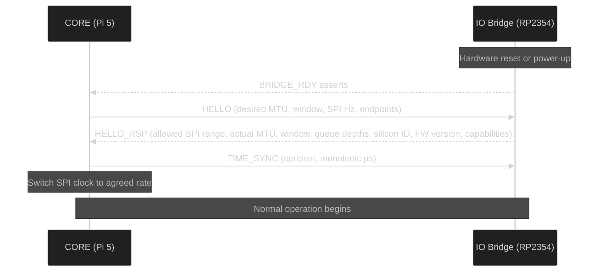

# Boot Sequence

## Overview

TheCube boots through a staged sequence that brings up the CORE runtime, establishes the IO Bridge link, and starts app services.

---

## Init Order

1. **Power-on / Reset** — hardware initialization and kernel boot.
2. **systemd service orchestration** — system services start in dependency order.
3. **CORE launch** — `thecube-core.service` starts the main runtime.
4. **IO Bridge handshake** — CORE discovers and negotiates with the IO Bridge.
5. **App services** — apps are launched as individual systemd services after CORE is ready.

---

## IO Bridge Bring-Up

The IO Bridge handshake is a critical part of boot. The bridge must be ready before any expansion I/O is available.

### HELLO_RSP Capabilities

The bridge reports its full capability set during handshake:

- Protocol version and firmware version
- Silicon / board identifier
- Supported SPI frequency range
- Negotiated MTU and queue depths / credits per endpoint
- Endpoint counts
- Feature flags: PIO support, watchdog, flash layout, optional CAN

### Boot Reason Events

After the bridge boots (including reboot or recovery), it sends `EVT:BOOT_REASON` so the CORE can determine why the bridge restarted and take appropriate action.

---

## Failure Modes & Safe Mode

### CORE Safe Mode

If the CORE fails to boot after repeated attempts, the Boot Manager falls back to the previous A/B slot automatically. If both slots fail, the system enters a minimal safe mode for recovery.

### Bridge Safe Mode

If the CORE↔BRIDGE link experiences repeated CRC or framing errors (exceeding a threshold within a time window), the bridge enters a degraded mode:

- Lowers SPI frequency
- Drops to single outstanding frame
- Signals `EVT:FAULT{FRAMING_STORM}`

The CORE should detect this event and re-negotiate the link at the lower speed.

### Bridge Recovery

The bridge firmware uses an A/B slot strategy:

- Write only to the inactive slot
- Verify fully before activation
- Mark pending on reboot
- Require "boot good" confirmation (`WDT_MARK_GOOD`) from the CORE after successful startup
- Roll back automatically on repeated failure

The bridge's watchdog requires periodic petting from the CORE via `CTRL.WDT_PET`. If the CORE fails to pet, the bridge reboots, asserts `BRIDGE_RDY=0→1`, and sends `EVT:BOOT_REASON`. The CORE should re-`HELLO` to re-establish the session.

---

## Timing Targets

| Milestone                            | Target         |
| ------------------------------------ | -------------- |
| First boot to ready                  | < 20 seconds   |
| Bridge handshake (HELLO → HELLO_RSP) | < 1 ms typical |
| Wakeword → first remote-audio response start | < 1.5 s |

---

## Diagnostics

- Bridge handshake failures are logged to `/var/log/thecube/core.log`.
- Bridge boot reason is logged on every CORE↔BRIDGE session establishment.
- `GET /health` HTTP endpoint reports bridge link status as part of component health.

---

## See Also

- [Hardware: Expansion & IO Bridge](/hardware/expansion/) — bridge architecture and handshake details
- [Architecture](/core/architecture/) — system-level component overview
- [Security](/core/security/) — safe mode and firmware integrity
