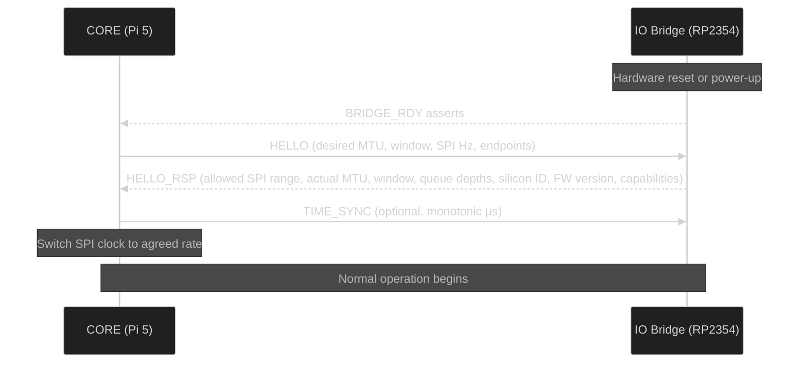

# Boot Sequence

<<<<<<< HEAD
-   Init services
-   Fallbacks & safe-mode
-   Logs & diagnostics

# TheCube – Fast Boot + SDL2 Migration + RetroPie Integration Plan

## Overview
This document details the plan for:
1. Optimizing boot time on Raspberry Pi 5.
2. Creating an early boot splash using initramfs + KMS/DRM.
3. Migrating TheCube CORE UI from SFML to SDL2.
4. Integrating RetroPie with clean DRM master handoff and future overlay support.

---

## 1. Boot Time Optimization Plan

### Current Boot Sequence
1. **Firmware**  
   Loads GPU firmware, parses `config.txt`, loads kernel/initramfs.
2. **Kernel/initramfs**  
   Initializes drivers, mounts root FS.
3. **Systemd**  
   Launches services, UI starts last.

**Delays:**
- Bootloader delay.
- Unused kernel modules.
- Unneeded systemd services.
- Filesystem checks.
- Network waits.

---

### Targets
- Bootloader delay: **0 s**.
- Kernel/initramfs: only essential modules.
- UI starts **before** `multi-user.target`.
- Splash visible <2 s, UI <4 s.

---

### Optimizations

**Bootloader:**
Edit `/boot/firmware/config.txt`:
```ini
disable_splash=1
disable_overscan=1
framebuffer_width=720
framebuffer_height=720
dtoverlay=vc4-kms-v3d
```

Edit `/boot/firmware/cmdline.txt` (single line):
```
console=tty3 loglevel=3 quiet vt.global_cursor_default=0 splash
```

**Service Trimming:**
```bash
sudo systemctl mask bluetooth.service
sudo systemctl mask triggerhappy.service
sudo systemctl mask avahi-daemon.service
```

**Filesystem Mount Options:**
Edit `/etc/fstab`:
```fstab
PARTUUID=xxxx-xxxx / ext4 defaults,noatime,nodiratime 0 1
```

**Early UI Start:**
`/etc/systemd/system/thecube-ui.service`
```ini
[Unit]
DefaultDependencies=no
After=systemd-udev-settle.service
Before=multi-user.target

[Service]
Type=simple
ExecStart=/usr/local/bin/thecube-core
Environment=SDL_VIDEODRIVER=kmsdrm
Restart=always

[Install]
WantedBy=multi-user.target
```

---

## 2. Boot Splash Creation Plan

### Goals
- Earliest possible screen draw.
- Minimal dependencies.
- Smooth handoff to SDL2 UI.

---

### Approach
- **Initramfs** + custom DRM/KMS C program.
- Draws solid background + logo.
- Leaves buffer until UI starts.

---

### Splash Program (`splash.c`)
```c
#include <fcntl.h>
#include <stdint.h>
#include <stdio.h>
#include <string.h>
#include <sys/ioctl.h>
#include <sys/mman.h>
#include <unistd.h>
#include <xf86drm.h>
#include <xf86drmMode.h>
#include <drm/drm.h>
#include <drm/drm_mode.h>

static void fill(uint32_t *buf, int w, int h, uint32_t color) {
    for (int i = 0; i < w * h; i++) buf[i] = color;
}

int main(void) {
    int fd = drmOpen("vc4", NULL);
    if (fd < 0) fd = open("/dev/dri/card0", O_RDWR | O_CLOEXEC);
    if (fd < 0) return 1;

    drmModeRes *res = drmModeGetResources(fd);
    drmModeConnector *conn = NULL;
    uint32_t conn_id = 0, crtc_id = 0;
    for (int i = 0; i < res->count_connectors; i++) {
        conn = drmModeGetConnector(fd, res->connectors[i]);
        if (conn->connection == DRM_MODE_CONNECTED && conn->count_modes) {
            conn_id = conn->connector_id;
            break;
        }
        drmModeFreeConnector(conn);
    }
    drmModeModeInfo mode = conn->modes[0];
    drmModeEncoder *enc = drmModeGetEncoder(fd, conn->encoder_id);
    crtc_id = enc->crtc_id;

    struct drm_mode_create_dumb creq = {0};
    creq.width = mode.hdisplay;
    creq.height = mode.vdisplay;
    creq.bpp = 32;
    ioctl(fd, DRM_IOCTL_MODE_CREATE_DUMB, &creq);

    uint32_t fb_id;
    struct drm_mode_fb_cmd cmd = {
        .width = mode.hdisplay, .height = mode.vdisplay,
        .bpp = 32, .depth = 24, .pitch = creq.pitch,
        .handle = creq.handle
    };
    ioctl(fd, DRM_IOCTL_MODE_ADDFB, &cmd);
    fb_id = cmd.fb_id;

    struct drm_mode_map_dumb mreq = { .handle = creq.handle };
    ioctl(fd, DRM_IOCTL_MODE_MAP_DUMB, &mreq);
    uint32_t *map = mmap(0, creq.size, PROT_READ | PROT_WRITE, MAP_SHARED, fd, mreq.offset);

    // Fill background (ARGB) — dark grey
    fill(map, mode.hdisplay, mode.vdisplay, 0xFF1E1E1E);

    drmModeSetCrtc(fd, crtc_id, fb_id, 0, 0, &conn_id, 1, &mode);

    usleep(1000 * 150);
    return 0;
}
```
Compile:
```bash
gcc splash.c -o splash -ldrm
```

---

### Initramfs Layout
```
initrd/
 ├─ sbin/splash
 ├─ bin/busybox
 ├─ init
```

**`init` script:**
```sh
#!/bin/sh
mount -t proc proc /proc
mount -t sysfs sysfs /sys
mount -t devtmpfs devtmpfs /dev

i=0
while [ ! -e /dev/dri/card0 ] && [ $i -lt 50 ]; do
    sleep 0.05
    i=$((i+1))
done

if [ -e /dev/dri/card0 ]; then
    /sbin/splash || true
fi

ROOTDEV=$(cat /proc/cmdline | sed -n 's/.*root=\([^ ]*\).*/\1/p')
[ -n "$ROOTDEV" ] || ROOTDEV="/dev/mmcblk0p2"
mkdir -p /newroot
mount "$ROOTDEV" /newroot
exec switch_root /newroot /sbin/init
```

Pack:
```bash
find . -print0 | cpio --null -ov --format=newc | gzip -9 > ../initramfs.gz
```

Edit `/boot/firmware/config.txt`:
```
initramfs initramfs.gz followkernel
```

---

## 3. SDL2 Migration Plan

### Rationale
- Drop WM dependency.
- Direct KMS/DRM rendering.
- Works under X11 for devs.
- Lower latency.

---

### Install
```bash
sudo apt install libsdl2-dev libsdl2-image-dev libsdl2-ttf-dev libsdl2-mixer-dev
```

---

### Minimal KMS/DRM SDL2 Loop
```cpp
#include <SDL2/SDL.h>
#include <SDL2/SDL_image.h>
#include <iostream>

SDL_Window* window = nullptr;
SDL_Renderer* renderer = nullptr;
bool running = true;

void init() {
    SDL_Init(SDL_INIT_VIDEO | SDL_INIT_AUDIO | SDL_INIT_EVENTS);
    SDL_SetHint(SDL_HINT_RENDER_DRIVER, "opengles2");
    window = SDL_CreateWindow("TheCube",
        SDL_WINDOWPOS_UNDEFINED, SDL_WINDOWPOS_UNDEFINED,
        720, 720, SDL_WINDOW_FULLSCREEN | SDL_WINDOW_OPENGL);
    renderer = SDL_CreateRenderer(window, -1,
        SDL_RENDERER_ACCELERATED | SDL_RENDERER_PRESENTVSYNC);
}

void draw() {
    SDL_SetRenderDrawColor(renderer, 30, 30, 30, 255);
    SDL_RenderClear(renderer);
    SDL_Rect rect = { 100, 100, 200, 200 };
    SDL_SetRenderDrawColor(renderer, 0, 200, 0, 255);
    SDL_RenderFillRect(renderer, &rect);
    SDL_RenderPresent(renderer);
}

void cleanup() {
    SDL_DestroyRenderer(renderer);
    SDL_DestroyWindow(window);
    SDL_Quit();
}

int main() {
    init();
    SDL_Event e;
    while (running) {
        while (SDL_PollEvent(&e)) {
            if (e.type == SDL_QUIT) running = false;
            if (e.type == SDL_KEYDOWN && e.key.keysym.sym == SDLK_ESCAPE) running = false;
        }
        draw();
    }
    cleanup();
    return 0;
}
```

Run without X:
```bash
SDL_VIDEODRIVER=kmsdrm SDL_AUDIODRIVER=alsa ./thecube
```

---

## 4. RetroPie Integration Plan

### Goals
- Launch RetroPie from CORE.
- CORE continues background tasks.
- Clean return to UI.

---

### Execution Flow
1. CORE destroys SDL window → releases DRM master.
2. Switch VT, run RetroPie:
```bash
openvt -s -w -c 7 -- /usr/bin/emulationstation
```
3. On exit, `chvt 1`, restart CORE UI.

---

### Systemd Units

**UI (`/etc/systemd/system/thecube-ui.service`):**
```ini
[Unit]
Description=TheCube CORE UI
After=multi-user.target
[Service]
TTYPath=/dev/tty1
ExecStart=/usr/local/bin/thecube-core
```

**RetroPie (`/etc/systemd/system/retropie.service`):**
```ini
[Unit]
Description=RetroPie
Conflicts=thecube-ui.service
[Service]
TTYPath=/dev/tty7
ExecStart=/usr/bin/openvt -s -w -c 7 -- /usr/bin/emulationstation
```

---

### Future Overlays

IPC format (JSON):
```json
{"type":"toast","title":"New Message","body":"Alex: Launch moved to 3 PM"}
```

CORE send helper:
```cpp
#include <sys/socket.h>
#include <sys/un.h>
#include <unistd.h>

void send_overlay(const std::string& json) {
    int fd = socket(AF_UNIX, SOCK_DGRAM | SOCK_CLOEXEC, 0);
    if (fd < 0) return;
    sockaddr_un addr{};
    addr.sun_family = AF_UNIX;
    strcpy(addr.sun_path, "/run/thecube/overlay.sock");
    sendto(fd, json.data(), json.size(), 0,
           (sockaddr*)&addr, sizeof(addr));
    close(fd);
}
```

---

### Testing
- Switch back and forth 5–10 times without DRM errors.
- Verify UI auto-restores on RetroPie exit.

---

## Conclusion
Following this plan:
- Boot to splash in ~2 s.
- CORE UI ready in ~4 s.
- No WM required.
- Seamless RetroPie integration with future-proof overlays.

=======
## Overview

TheCube boots through a staged sequence that brings up the CORE runtime, establishes the IO Bridge link, and starts app services.

---

## Init Order

1. **Power-on / Reset** — hardware initialization and kernel boot.
2. **systemd service orchestration** — system services start in dependency order.
3. **CORE launch** — `thecube-core.service` starts the main runtime.
4. **IO Bridge handshake** — CORE discovers and negotiates with the IO Bridge.
5. **App services** — apps are launched as individual systemd services after CORE is ready.

---

## IO Bridge Bring-Up

The IO Bridge handshake is a critical part of boot. The bridge must be ready before any expansion I/O is available.



### HELLO_RSP Capabilities

The bridge reports its full capability set during handshake:

- Protocol version and firmware version
- Silicon / board identifier
- Supported SPI frequency range
- Negotiated MTU and queue depths / credits per endpoint
- Endpoint counts
- Feature flags: PIO support, watchdog, flash layout, optional CAN

### Boot Reason Events

After the bridge boots (including reboot or recovery), it sends `EVT:BOOT_REASON` so the CORE can determine why the bridge restarted and take appropriate action.

---

## Failure Modes & Safe Mode

### CORE Safe Mode

If the CORE fails to boot after repeated attempts, the Boot Manager falls back to the previous A/B slot automatically. If both slots fail, the system enters a minimal safe mode for recovery.

### Bridge Safe Mode

If the CORE↔BRIDGE link experiences repeated CRC or framing errors (exceeding a threshold within a time window), the bridge enters a degraded mode:

- Lowers SPI frequency
- Drops to single outstanding frame
- Signals `EVT:FAULT{FRAMING_STORM}`

The CORE should detect this event and re-negotiate the link at the lower speed.

### Bridge Recovery

The bridge firmware uses an A/B slot strategy:

- Write only to the inactive slot
- Verify fully before activation
- Mark pending on reboot
- Require "boot good" confirmation (`WDT_MARK_GOOD`) from the CORE after successful startup
- Roll back automatically on repeated failure

The bridge's watchdog requires periodic petting from the CORE via `CTRL.WDT_PET`. If the CORE fails to pet, the bridge reboots, asserts `BRIDGE_RDY=0→1`, and sends `EVT:BOOT_REASON`. The CORE should re-`HELLO` to re-establish the session.

---

## Timing Targets

| Milestone                            | Target         |
| ------------------------------------ | -------------- |
| First boot to ready                  | < 20 seconds   |
| Bridge handshake (HELLO → HELLO_RSP) | < 1 ms typical |
| Wakeword → TTS start (local)         | < 500 ms       |
| Wakeword → TTS start (cloud)         | < 1.5 s        |

---

## Diagnostics

- Bridge handshake failures are logged to `/var/log/thecube/core.log`.
- Bridge boot reason is logged on every CORE↔BRIDGE session establishment.
- `GET /health` HTTP endpoint reports bridge link status as part of component health.

---

## See Also

- [Hardware: Expansion & IO Bridge](/hardware/expansion/) — bridge architecture and handshake details
- [Architecture](/core/architecture/) — system-level component overview
- [Security](/core/security/) — safe mode and firmware integrity
>>>>>>> 6bafbb1 (Enhance documentation for TheCube CORE and hardware components)
